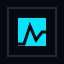
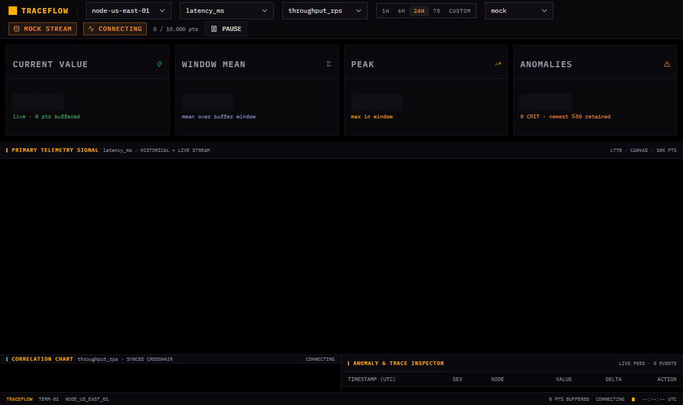
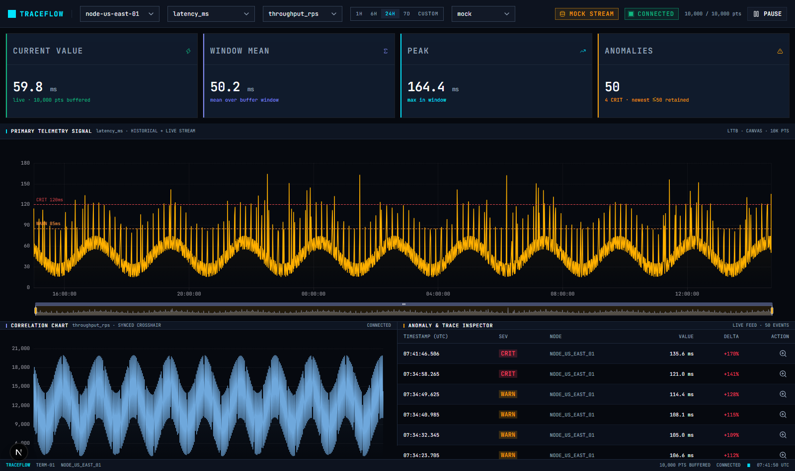
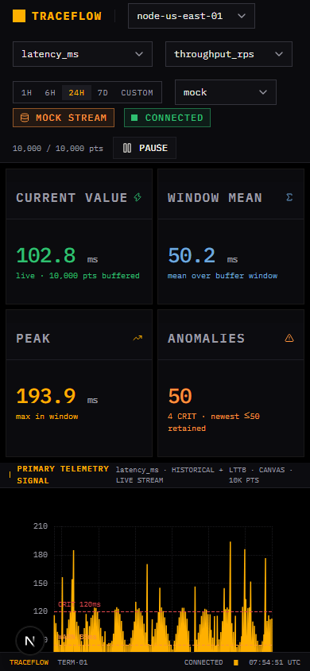
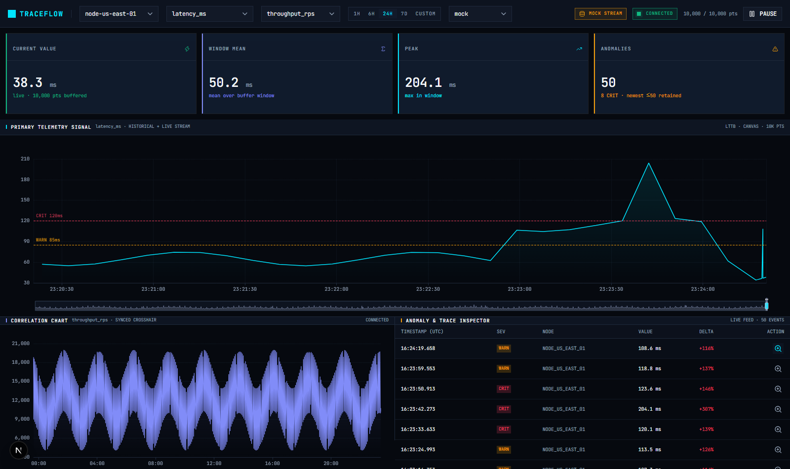
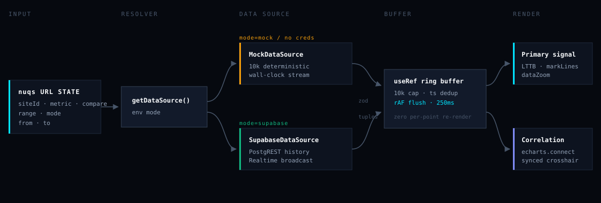
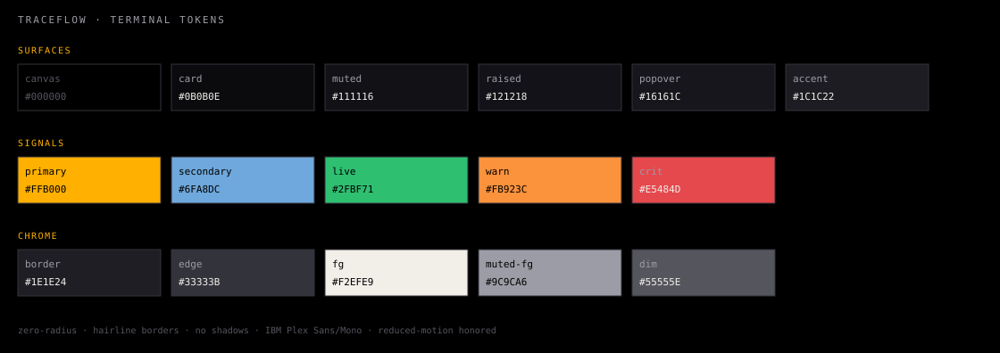

<div align="center">



# TraceFlow

**Ops-terminal real-time telemetry dashboard**

10,000-point ring buffer · LTTB-sampled canvas traces · Supabase Realtime + deterministic mock · URL-driven filters


</div>



---

## Why TraceFlow

Real-time dashboards usually break in one of three ways: React re-render storms
from high-frequency streams, chart libraries that choke past a few thousand
points, or "live" demos that need a running backend. TraceFlow is built around
solving all three:

| Problem | TraceFlow's answer |
|---|---|
| Streaming React state churn | Points land in a `useRef` ring buffer (10k cap) and flush to ECharts on a throttled `requestAnimationFrame` — zero per-point renders |
| Chart perf at 10k+ pts | Tree-shaken `echarts/core` + CanvasRenderer, LTTB downsampling, `large` mode, `useDirtyRect` |
| No backend handy | `MockDataSource` — deterministic 10k-point windows + wall-clock-anchored live batches; swap to Supabase by env var, zero code changes |

## Features

- **Primary telemetry signal** — 24h historical window + live stream on one trace, WARN/CRIT threshold markLines, `inside` + `slider` dataZoom
- **Synced correlation chart** — second metric on a shared `echarts.connect` group (synchronized crosshair + zoom), pickable from the header
- **Anomaly inspector** — severity-badged live feed; click a row's zoom action to focus the primary chart ±2 min around any event
- **URL as the single source of truth** — `siteId`, `metric`, `compare`, `range` (`1h/6h/24h/7d/custom`), `mode`, `from`/`to` via nuqs; survives reload and is shareable
- **Pause/resume** — freeze the stream without losing buffered data
- **KPI row** — current value, window mean, peak, retained anomalies — values carry their signal color, with skeleton loading
- **Ops-terminal chrome** — function-key range strip `[1H]…[CUSTOM]`, blinking block caret, bottom status bar with live UTC clock
- **Responsive floor** — measured `overflowX = 0` from 2560px down to 320px; tables and controls wrap instead of clipping
- **Terminal design system** — zero radius, hairline borders, 3-tier border hierarchy, signal-color tokens, `prefers-reduced-motion` support
- **Security posture** — CSP + nosniff + DENY framing + Referrer-Policy on every route; zod-validated external payloads; no secrets in repo

## Screenshots

<table>
  <tr>
    <td width="65%"></td>
    <td></td>
  </tr>
  <tr>
    <td colspan="2"></td>
  </tr>
</table>

## Architecture



Points flow through a ref-held ring buffer — **no per-point React state** —
and hit the charts on a 250ms `requestAnimationFrame` tick. Data contract —
zero-transformation tuples, validated once at the source boundary:

```ts
type TimeSeriesPoint = readonly [timestampMs: number, value: number]
```

## Data modes

| `NEXT_PUBLIC_DATA_MODE` | Behavior |
|---|---|
| `mock` | Always deterministic mock (default for tests/e2e) |
| `supabase` | Strict Supabase — throws a clear config error without credentials |
| `hybrid` *(default)* | Supabase when env vars exist, mock fallback otherwise |

```bash
# .env.local — only needed for supabase/hybrid-with-creds
NEXT_PUBLIC_DATA_MODE=hybrid
NEXT_PUBLIC_SUPABASE_URL=https://<ref>.supabase.co
NEXT_PUBLIC_SUPABASE_ANON_KEY=<anon-key>
```

The Supabase source queries a `telemetry_points` table
(`site_id, metric, ts_ms, value`) and subscribes to the
`telemetry:<siteId>:<metric>` broadcast channel — payloads are validated with
Zod before touching the buffer.

## Quickstart

```bash
pnpm install
pnpm dev          # http://localhost:3000
```

```bash
pnpm run lint         # eslint
pnpm run typecheck    # tsc --noEmit
pnpm test             # vitest — 34 unit tests
pnpm test:e2e         # 3 playwright tests (needs dev server on :3000)
pnpm run build && pnpm start
```

## Tech stack

| Layer | Choice |
|---|---|
| Framework | Next.js 16 App Router · React 19 · TypeScript strict |
| Charts | Apache ECharts — modular `echarts/core`, CanvasRenderer |
| URL state | nuqs (`NuqsAdapter` on the root layout) |
| Data fetching | TanStack Query (`staleTime: 30s`, no refetch-on-focus) |
| Backend | Supabase (`@supabase/ssr` client, PostgREST + Realtime) |
| Validation | Zod contracts at every external boundary |
| Styling | Tailwind 4 + shadcn/ui (base-nova) + Lucide icons |
| Tests | Vitest + jsdom (fake timers, rAF stubs) · Playwright |

## Design system

Derived from `.devin/stitch/DESIGN.md` — ops-terminal (Bloomberg-style) conventions:



- **Surfaces** `#000` canvas → `#0B0B0E` panel → `#111116` focused → `#121218` raised → `#1C1C22` elevated
- **Border tiers** `#1E1E24` structural · `#33333B` interactive controls · signal-color accents
- **Signals** amber `#FFB000` primary · steel `#6FA8DC` secondary · green `#2FBF71` live · orange `#FB923C` warn · red `#E5484D` crit
- **Type** IBM Plex Sans (UI) + IBM Plex Mono tabular-nums (data) — label-caps at 9–10px / `0.08em` tracking
- **Rules** zero radius · no fuzzy shadows · hairlines only · `prefers-reduced-motion` honored

## Project layout

```
src/
├── app/                    # RSC shell, globals.css tokens
├── components/
│   ├── charts/             # EChartCanvas (init/setOption/dispose lifecycle)
│   ├── dashboard/          # HeaderFilterBar, KpiCards, charts, AnomalyStreamTable, StatusBar
│   └── ui/                 # shadcn primitives
├── hooks/                  # useRealtimeChartBuffer (ring buffer + rAF flush)
├── lib/
│   ├── data/               # contracts, metrics registry, mock/supabase sources, factory
│   ├── echarts-setup.ts    # tree-shaken echarts singleton
│   ├── chart-theme.ts      # canvas-facing color constants
│   └── search-params.ts    # nuqs parsers
e2e/                        # Playwright specs
docs/                       # issues/, releases/, BRANCHING.md, assets/
```

## Development docs

- [`docs/issues/`](docs/issues/README.md) — local issue tracker (18 closed)
- [`docs/BRANCHING.md`](docs/BRANCHING.md) — trunk-based, `fix/issue-NNN-*`, `release/x.y.z`
- [`CHANGELOG.md`](CHANGELOG.md) — Keep-a-Changelog + SemVer, latest **v0.4.0**
- [`.devin/stitch/DESIGN.md`](.devin/stitch/DESIGN.md) — design token source of truth
